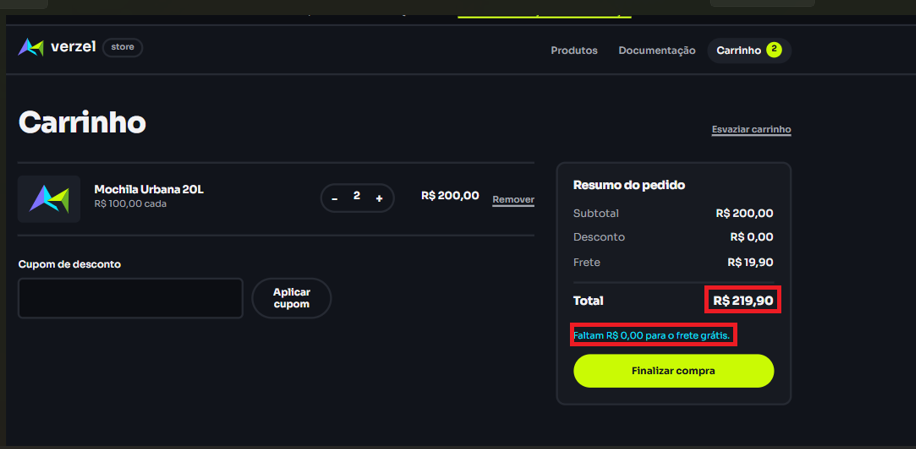
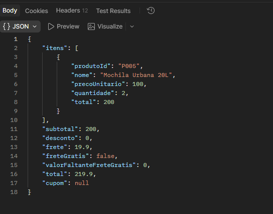

# 🐛 [BUG] Frete grátis não é aplicado ao atingir o subtotal limite de R$ 200,00

## 📌 Informações Gerais
* **ID do Bug:** `BUG-VZS-142-01`
* **Card Relacionado:** `VZS-142` (Cupom de Desconto e Frete Grátis)
* **Critérios de Aceite Afetados:** 
  * `CA06` - Frete grátis automático a partir de R$ 200,00 (inclusive).
* **Severidade:** Alta (Cobrança indevida de taxa do cliente e divergência na régua de incentivo)
* **Prioridade:** Alta (Gargalo direto na conversão de vendas)
* **Ambiente:** Staging / Web (Google Chrome)
* **Relatora:** Bianca Gomes de Lira
* **Data:** 07/10/2026

---

## 🎯 Resumo / Descrição
Ao adicionar produtos ao carrinho que totalizam exatamente R$ 200,00 (valor limite para isenção da taxa de frete), o sistema exibe a mensagem de apoio *"Faltam R$ 0,00 para o frete grátis"*, reconhecendo que o valor mínimo foi alcançado. Contudo, o sistema **não zera a taxa de frete** (mantendo o valor fixo de R$ 19,90) e **não exibe o indicador visual/badge de "Frete Grátis"**.

---

## 🔄 Passos para Reprodução

1. Acesse a Verzel Store no ambiente de Staging.
2. Adicione ao carrinho 2 unidades do produto "Mochila Urbana 20L" (R$ 100,00 cada), atingindo o subtotal de R$ 200,00.
3. Observe o resumo do pedido no lado direito da tela.
4. Verifique o valor cobrado no campo **Frete** e a ausência do indicador de benefício.

---

## ❌ Comportamento Atual (Incorreto)
* **Subtotal dos Produtos:** R$ 200,00
* **Mensagem da Régua:** *"Faltam R$ 0,00 para o frete grátis."*
* **Frete:** **R$ 19,90** ❌ *(Incorreto: a taxa de R$ 19,90 continua sendo cobrada)*
* **Total do Pedido:** **R$ 219,90**
* **Indicador Visual:** Nenhuma tag/badge de "Frete Grátis" é exibida na interface.

---

## ✅ Comportamento Esperado
* **Subtotal dos Produtos:** R$ 200,00
* **Frete:** **R$ 0,00 (Grátis)** ✅
* **Total do Pedido:** **R$ 200,00**
* **Indicador Visual:** Exibição da informação/badge de "Frete Grátis" aplicado.

---

## 📸 Evidências




```json
// Payload de Resposta da API de cálculo (`POST /api/cart/calculate`)
{
  "subtotal": 200.00,
  "desconto": 0,
  "frete": 19.90, // <--- BUG: Deveria ser 0.00 quando subtotal >= 200.00
  "FreteGratis": false, // <--- BUG: Deveria ser true
  "ValorFaltanteFreteGratis": 0.00,
  "total": 219.90,
  "cupom": null
}