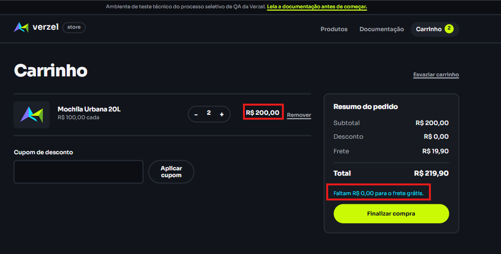
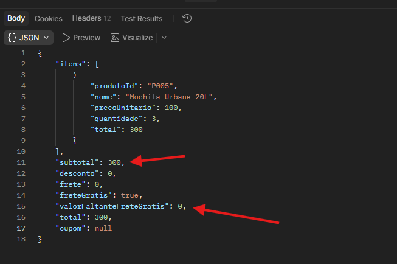

# 🐛 [BUG] Omissão da mensagem de progresso de frete grátis quando o subtotal ultrapassa o limite de R$ 200,00

## 📌 Informações do Relatório
* **ID do Bug:** `BUG-VZS-142-02`
* **Card Relacionado:** `VZS-142` (Cupom de Desconto e Frete Grátis)
* **Critérios de Aceite Afetados:** 
* `CA06` - O frete é grátis para compras com subtotal a partir de R$ 200,00, inclusive.
* `CA07` - Abaixo de R$ 200,00, é cobrado frete fixo de R$ 19,90 e o carrinho informa quanto falta para o frete grátis.
* **Severidade:** Baixa
* **Prioridade:** Baixa
* **Ambiente:** Staging / Web (Google Chrome)
* **Relatora:** Bianca Gomes de Lira
* **Data:** 07/10/2026
* **Módulo:** Carrinho de Compras / Interface de Resumo do Pedido

---

## 🎯 Resumo / Descrição
Quando o subtotal do carrinho ultrapassa o limite estabelecido de R$ 200,00 para frete grátis (por exemplo, atingindo R$ 300,00), a mensagem informativa que indica o progresso do benefício desaparece completamente da interface, quebrando a consistência de feedback visual observada nos estados anteriores.

---

## 🔄 Passos para Reproduzir
1. Acessar a aplicação da Verzel Store.
2. Adicionar o produto "Mochila Urbana 20L" ao carrinho.
3. Ajustar a quantidade para **3** unidades, fazendo com que o subtotal atinja **R$ 300,00**.
4. Observar a área do resumo do pedido logo abaixo do valor total.

---

## ❌ Comportamento Atual (Inconsistente)
* O bloco de texto informativo de quanto falta para o frete grátis deixa de ser renderizado no ecrã. Enquanto no subtotal de R$ 200,00 o sistema exibia explicitamente *"Faltam R$ 0,00 para o frete grátis", ao ultrapassar esse valor o campo simplesmente some, deixando o espaço em branco e gerando uma quebra de padrão no feedback para o utilizador.

---

## ✅ Comportamento Esperado
* O sistema deve manter um feedback visual claro e coeso no resumo do pedido em todos os cenários onde o limite de frete grátis foi alcançado ou superado (por exemplo, mantendo uma frase de confirmação de benefício atingido ou exibindo uma mensagem positiva equivalente), garantindo consistência na experiência de utilização.

---

## 📷 Evidências

