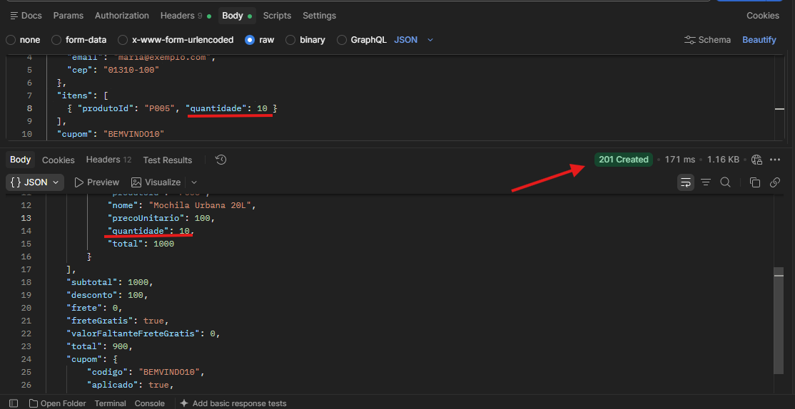
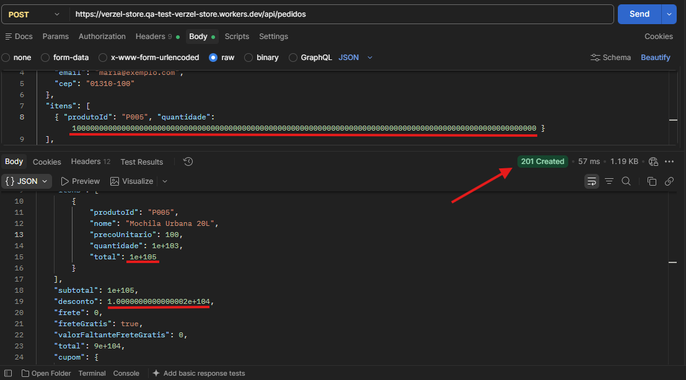

# 🐛 [BUG] Ausência de limite máximo e overflow numérico no campo quantidade ao criar pedido

## 📌 Informações Gerais

* **ID do Bug:** `BUG-VZS-142-03`
* **Card Relacionado:** `VZS-142` (Validação de Regras de Negócio e Integridade de Pedidos)
* **Critérios de Aceite Afetados:**
*  `CA10` - Cada produto pode ter no máximo 5 unidades por pedido. A regra vale para a interface e para a API. 
*  `CA11` - Todos os valores são arredondados para 2 casas decimais.  
* **Severidade:** Alta (Inconsistência nas regras de negócio e falha no tratamento de overflow no backend)
* **Prioridade:** Alta (Risco de comprometimento da integridade dos dados do pedido e indisponibilidade)
* **Ambiente:** Staging / API (`POST /api/pedidos`)
* **Relatora:** Bianca Gomes de Lira
* **Data:** 08/10/2026

---

## 🎯 Resumo / Descrição

A API valida corretamente o limite inferior do campo `quantidade`, rejeitando valores zerados ou negativos com retorno **HTTP 422 Unprocessable Entity**. Entretanto, não aplica uma validação de limite máximo para a quantidade de itens e também não trata adequadamente entradas numéricas extraordinariamente grandes.

Ao enviar uma quantidade superior ao limite permitido pela regra de negócio, a API aceita a requisição e retorna **HTTP 201 Created**, permitindo a criação do pedido.

Quando são enviados valores numéricos extremamente grandes, a API também realiza os cálculos financeiros sem aplicar uma validação de capacidade numérica, resultando em valores em **notação científica**, como `1e+206` e `1.0000000000000001e+208`.

Esse comportamento permite que valores inválidos sejam processados e utilizados nos cálculos de subtotal, desconto e total do pedido, comprometendo a **integridade dos dados financeiros**.

---

## 🔄 Passos para Reprodução

1. Abra a ferramenta de testes de API, como o Postman.
2. Configure uma requisição `POST` para o endpoint `https://verzel-store.qa-test-verzel-store.workers.dev/api/pedidos`.
3. Defina o header:* `Content-Type: application/json`
4. No corpo da requisição (`Body > raw > JSON`), informe uma quantidade superior ao limite permitido ou um número com dezenas de dígitos:

```json
{
  "cliente": {
    "nome": "Maria Silva",
    "email": "maria@exemplo.com",
    "cep": "01310-100"
  },
  "itens": [
    {
      "produtoId": "P005",
      "quantidade": 10000000000000000000000000000000000000000000000000000000000000000000000000000000000000000000000000000000
    }
  ],
  "cupom": "BEMVINDO10"
}
```

5. Clique em **Send**. (Method: POST)
6. Analise o código HTTP retornado e os valores presentes no JSON de resposta.
7. Verifique se a quantidade informada foi aceita e utilizada nos cálculos financeiros.

---

## ❌ Comportamento Atual (Incorreto)

* **Status HTTP:** `201 Created` ❌
  * A API aceita a requisição e cria o pedido mesmo com uma quantidade que excede o limite permitido e/ou apresenta magnitude numérica incompatível com o processamento esperado.
* **Limite máximo:** Não existe bloqueio para quantidades acima do limite máximo definido pela regra de negócio.
* **Quantidade processada:** O valor extraordinariamente grande é aceito pela API.
* **Cálculo financeiro:** A API realiza os cálculos utilizando o valor numérico em overflow.
* **Representação dos valores:** Os campos `quantidade`, `subtotal`, `desconto` e `total` podem ser retornados em notação científica, como `1e+206` e `1.0000000000000001e+208`.
* **Aplicação do cupom:** O desconto também é calculado sobre o valor numérico inválido, resultando em valores como `1e+207`.
* **Integridade do pedido:** O pedido é criado com valores financeiros incompatíveis com uma operação comercial válida.

---

## ✅ Comportamento Esperado

* **Validação de limite de negócio:** A API deve rejeitar quantidades superiores ao limite máximo permitido por item, definido como **5 unidades**.
* **Validação de entrada:** Valores numéricos que excedam a capacidade ou os limites definidos para o campo devem ser rejeitados antes da realização dos cálculos.
* **Prevenção de overflow:** A camada de validação deve impedir que valores numericamente inválidos sejam utilizados nos cálculos financeiros.
* **Status HTTP:** A API deve retornar `422 Unprocessable Entity` ou `400 Bad Request`.
* **Criação do pedido:** O pedido não deve ser criado quando a quantidade estiver fora dos limites permitidos.
* **Mensagem de erro:** A resposta deve informar claramente o campo e o motivo da rejeição.

Exemplo de resposta esperada:

```json
{
  "erro": {
    "codigo": "QUANTIDADE_EXCEDIDA",
    "mensagem": "A quantidade informada excede o limite máximo permitido por item.",
    "campo": "itens[0].quantidade"
  }
}
```

---

## 📸 Evidências 




### Resposta da API com quantidade em overflow

```json
{
  "itens": [
    {
      "produtoId": "P005",
      "nome": "Mochila Urbana 20L",
      "precoUnitario": 100,
      "quantidade": 1e+206,
      "total": 1.0000000000000001e+208
    }
  ],
  "subtotal": 1.0000000000000001e+208,
  "desconto": 1e+207,
  "frete": 0,
  "freteGratis": true,
  "valorFaltanteFreteGratis": 0,
  "total": 9.0000000000000001e+207,
  "cupom": {
    "codigo": "BEMVINDO10",
    "aplicado": true,
    "mensagem": "Cupom aplicado: 10% de desconto nos produtos."
  }
}
```

**Evidências observadas:**

* `quantidade`: `1e+206` ❌
* `subtotal`: `1.0000000000000001e+208` ❌
* `desconto`: `1e+207` ❌
* `total`: `9.0000000000000001e+207` ❌
* Pedido criado com **HTTP 201** apesar da quantidade inválida.
* Cupom aplicado sobre um valor numericamente inválido.

---