# 📋 Cenários de Teste - Verzel Store (Card VZS-142)

Este documento contém o levantamento de cenários de teste escritos em sintaxe BDD/Gherkin com base na documentação da entrega de **Cupom de Desconto e Frete Grátis**.

---

## 🎟️ Funcionalidade: Aplicação de Cupons de Desconto e Frete Grátis
**História de Usuário:** Como cliente da Verzel Store, quero aplicar um cupom de desconto e ganhar frete grátis em compras maiores, para pagar menos nas minhas compras.

### Cenário 01: Aplicar cupom de desconto válido (CA01, CA09)
- **Dado** que tenho produtos no carrinho com subtotal de R$ 100,00
- **Quando** aplico o cupom "BEMVINDO10"
- **Então** o desconto de 10% deve ser aplicado sobre o subtotal
- **E** o desconto deve ser de R$ 10,00
- **E** o frete deve continuar R$ 19,90
- **E** o total deve ser R$ 109,90

   **Resultado da Execução:** ✅ Passou
   **Evidência:**
   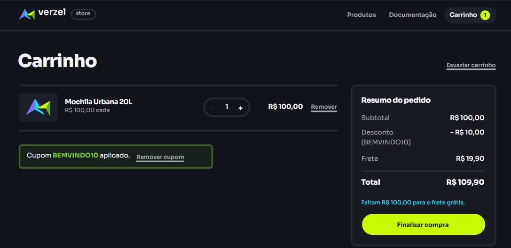 

### Cenário 02: Cupom aceito independente de maiúsculas, minúsculas e espaços nas pontas (CA02)
- **Dado** que tenho produtos no carrinho com subtotal de R$ 100,00
- **Quando** aplico o cupom `<codigo>`
- **Então** o cupom "BEMVINDO10" deve ser aplicado
- **E** o desconto deve ser de R$ 10,00
- **E** o total deve ser R$ 109,90
                                                                                

| codigo           | observação                      |
|---               |---                              |
| bemvindo10       | tudo minúsculo                  |
| BemVindo10       | caixa mista                     |
| " BEMVINDO10"    | espaço no início                |
| "BEMVINDO10 "    | espaço no fim                   |
| "  bemvindo10  " | minúsculas e espaços combinados |

   **Resultado da Execução:** ✅ Passou
   **Evidência:**
   

### Cenário 03: Cupom inexistente ou malformado não aplica desconto (CA02, CA03)
- **Dado** que tenho produtos no carrinho com subtotal de R$ 100,00
- **Quando** aplico o cupom `<codigo>`
- **Então** o sistema deve exibir a mensagem "Cupom inválido."
- **E** nenhum desconto deve ser aplicado
- **E** o total deve ser R$ 119,90

Exemplos:

| codigo        | observação                              |
|---            |---                                      |
| CUPOM123      | código aleatório                        |
| BEMVINDO11    | parecido com o válido, um dígito errado |
| BEMVINDO1     | código válido incompleto                |
| BEMVINDO100   | código válido com caractere a mais      |
| DESC@10       | caractere especial                      |
| "BEMVINDO 10" | espaço no meio não é ignorado           |

   **Resultado da Execução:** ✅ Passou
   **Evidência:**
   

### Cenário 04: Tentativa de aplicação de cupom expirado (CA04)
- **Dado** que tenho produtos no carrinho com subtotal de R$ 100,00
- **Quando** aplico o cupom "VERAO2026" (expirado em 31/03/2026)
- **Então** o sistema deve exibir a mensagem "Cupom expirado."
- **E** nenhum desconto deve ser aplicado
- **E** o total deve ser R$ 119,90

   **Resultado da Execução:** ✅ Passou
   **Evidência:**
   

  
  

### Cenário 05: Não permitir dois cupons ao mesmo tempo (CA05)
- **Dado** que tenho um produto adicionado ao carrinho
- **E** E aplico o cupom "BEMVINDO10" com sucesso
- **Quando** visualizo a seção de resumo do pedido
- **Então** o campo de texto para inserção de cupons não deve estar visível
- **E** o sistema deve exibir apenas a confirmação do cupom ativo junto à opção de remoção.

   **Resultado da Execução:** ✅ Passou
   **Evidência:**
   

  

### Cenário 06: Remover o cupom devolve o carrinho ao estado sem desconto (CA05)
- **Dado** que tenho um carrinho com subtotal de R$ 100,00
- **E** que o cupom "BEMVINDO10" está aplicado
- **Quando** removo o cupom "BEMVINDO10"
- **Então** nenhum cupom deve estar aplicado
- **E** o desconto deve ser R$ 0,00
- **E** o total deve ser R$ 119,90

   **Resultado da Execução:** ✅ Passou
   **Evidência:**
   

### Cenário 07: Frete e valor faltante em torno do limite de R$ 200,00 (CA06, CA07)
- **Dado** que o subtotal dos produtos no carrinho é R$ `<subtotal>`
- **Quando** visualizo o resumo do pedido
- **Então** o frete deve ser R$ `<frete>`
- **E** o valor faltante para o frete grátis deve ser `<faltante>`
- **E** a indicação de frete grátis deve estar `<indicacao>`
- **E** o total deve ser R$ `<total>`

Exemplos:

   | subtotal | frete | faltante    | indicacao | total  | como montar        | observação            |
   |---       |---    |---          |---        |---     |---                 |---                    |
01-| 29,90    | 19,90 | R$ 170,10   | oculta    | 49,80  | P006               | menor valor possível  |
02-| 100,00   | 19,90 | R$ 100,00   | oculta    | 119,90 | P005               | valor intermediário   |
03-| 199,90   | 19,90 | R$ 0,10     | oculta    | 219,80 | P004 + P005 + P008 | logo abaixo do limite |
04-| 200,00   | 0,00  | 0,00        | exibida   | 200,00 | P005 x2            | exatamente no limite  |
05-| 229,90   | 0,00  | 0,00        | exibida   | 229,90 | P007               | acima do limite       |

   **Resultado da Execução:(01)** ✅ Passou
   **Evidência:**
  ()

   **Resultado da Execução:(02)** ✅ Passou
   **Evidência:**
  

   **Resultado da Execução:(03)** ✅ Passou
   **Evidência:**
   

   **Resultado da Execução:(04)** ❌ Falhou
   **Evidência e Detalhes:** 
   [Ver Bug Report completo](../../bug-reports/BUG-VZS-142-01)

   **Resultado da Execução:(05)** ❌ Falhou
   **Evidência e Detalhes:** 
   [Ver Bug Report completo](../../bug-reports/BUG-VZS-142-02)

### Cenário 08: Valor faltante é recalculado ao alterar o carrinho (CA06, CA07)
- **Dado** que tenho no carrinho `<produtos>` com subtotal de R$ `<subtotal_inicial>`
- **Quando** `<acao>`
- **Então** o subtotal deve ser R$ `<subtotal_final>`
- **E** o frete deve ser R$ `<frete>`
- **E** o valor faltante para o frete grátis deve ser `<faltante>`

Exemplos:

   | produtos           | subtotal_inicial | acao                                | subtotal_final | frete | faltante    |
   |---                 |---               |---                                  |---             |---    |---          |
01-| P005 + P008        | 150,00           | adiciono o produto P006 (R$ 29,90)  | 179,90         | 19,90 | R$ 20,10    |
02-| P005 + P008 + P006 | 179,90           | removo o produto P006               | 150,00         | 19,90 | R$ 50,00    |
03-| P005 + P008        | 150,00           | adiciono o produto P005 (R$ 100,00) | 300,00         | 0,00  | R$ 00,00    |

   **Resultado da Execução:(01)** ✅ Passou
   **Evidência:**
  

   **Resultado da Execução:(02)** ✅ Passou
   **Evidência:**
   

   **Resultado da Execução:(03)** ✅ Passou
   **Evidência:**
  

### Cenário 09: Valor faltante é calculado sobre o subtotal, sem considerar o cupom (CA07, CA08, CA09)
- **Dado** que tenho produtos no carrinho com subtotal de R$ 150,00 (P005 + P008)
- **Quando** aplico o cupom "BEMVINDO10"
- **Então** o desconto deve ser R$ 15,00
- **E** o frete deve continuar R$ 19,90
- **E** o carrinho deve informar que faltam R$ 50,00 para o frete grátis
- **E** o total deve ser R$ 154,90

   **Resultado da Execução:** ✅ Passou
   **Evidência:**
  

### Cenário 10: Frete grátis avalia o subtotal antes do desconto (CA06, CA08)
- **Dado** que tenho produtos no carrinho com subtotal de R$ `<subtotal>`
- **Quando** aplico o cupom "BEMVINDO10"
- **Então** o desconto deve ser R$ `<desconto>`
- **E** o frete deve ser R$ `<frete>`
- **E** o total deve ser R$ `<total>`

Exemplos:

| subtotal | desconto | frete | total  | como montar        | observação                                     |
|---       |---       |---    |---     |---                 |---                                             |
| 199,90   | 19,99    | 19,90 | 199,81 | P004 + P005 + P008 | bruto abaixo do limite, frete cobrado          |
| 200,00   | 20,00    | 0,00  | 180,00 | P005 x2            | limite exato, pós-desconto abaixo de 200       |
| 219,80   | 21,98    | 0,00  | 197,82 | P003 + P006        | zona de risco: bruto ≥ 200, pós-desconto < 200 |

   **Resultado da Execução:** ✅ Passou
   **Evidência:**
    

   **Resultado da Execução:(02)** ❌ Falhou
   **Evidência e Detalhes:**
   

   **Resultado da Execução:** ✅ Passou
   **Evidência:**
   

### Cenário 11: Remover o cupom não altera o frete grátis (CA05, CA08)
- **Dado** que tenho produtos no carrinho com subtotal de R$ 300,00 (P005 x3)
- **E** que o cupom "BEMVINDO10" está aplicado
- **E** que o frete é R$ 0,00
- **Quando** removo o cupom "BEMVINDO10"
- **Então** o frete deve continuar R$ 0,00
- **E** o total deve ser R$ 300,00a

   **Resultado da Execução:** ✅ Passou
   **Evidência:**
   

### Cenário 12: Frete passa a ser grátis ao adicionar produto com cupom aplicado (CA06, CA08)
- **Dado** que tenho produtos no carrinho com subtotal de R$ 150,00 (P005 + P008)
- **E** que o cupom "BEMVINDO10" está aplicado
- **E** que o frete é R$ 19,90
- **Quando** adiciono o produto P001 (R$ 59,90)
- **Então** o subtotal deve ser R$ 209,90
- **E** o desconto deve ser R$ 20,90
- **E** o frete deve ser R$ 0,00
- **E** o total deve ser R$ 180,91

   **Resultado da Execução:** ✅ Passou
   **Evidência:**
    

## Cenário 13: Frete volta a ser cobrado ao cair abaixo de R$ 200,00 com cupom aplicado (CA06, CA08)
- **Dado** que tenho produtos no carrinho com subtotal de R$ 209,90 (P005 + P008 + P001)
- **E** que o cupom "BEMVINDO10" está aplicado com desconto de R$ 20,99
- **E** que o frete é Grátis
- **E** que o total é R$ 188,91
- **Quando** removo o produto P001 (R$ 59,90)
- **Então** o subtotal deve ser R$ 150,00
- **E** o desconto deve ser R$ 15,00
- **E** o frete deve ser R$ 19,90
- **E** o total deve ser R$ 154,90

   **Resultado da Execução:** ✅ Passou
   **Evidência:**
   

### Cenário 14: Impedir mais de 5 unidades do mesmo produto na interface (CA10)
- **Dado** que tenho 5 unidades do produto "Camiseta Essencial" (P001) no carrinho
- **Quando** visualizo o produto "Camiseta Essencial" na lista de produtos
- **Então** o botão "Adicionar ao carrinho" deve estar desabilitado
- **E** a mensagem "Limite de 5 unidades atingido." deve ser exibida
- **Quando** tento aumentar a quantidade de P001 pelo botão "+" na tela do carrinho
- **Então** a quantidade de P001 deve continuar 5

   **Resultado da Execução:** ✅ Passou
   **Evidência:**
   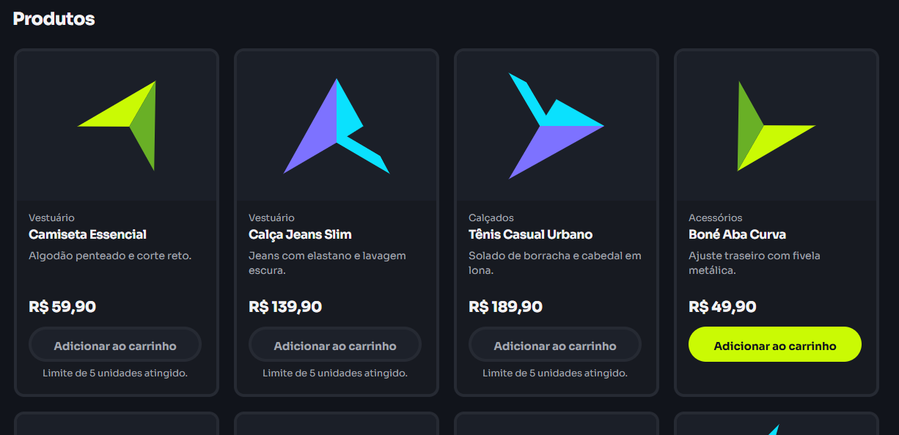

   **Resultado da Execução:** ✅ Passou
   **Evidência:**
   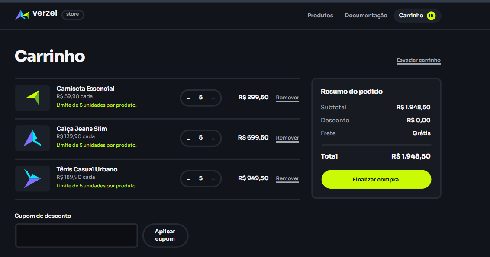

### Cenário 15: Valores monetários exibidos com 2 casas decimais (CA11)
- **Dado** que tenho no carrinho P001 x1, P004 x1 e P006 x5, com subtotal de R$ 259,30
- **Quando** aplico o cupom "BEMVINDO10"
- **Então** o desconto deve ser exibido como R$ 25,93
- **E** o total deve ser exibido como R$ 233,37

   **Resultado da Execução:** ✅ Passou
   **Evidência:**
   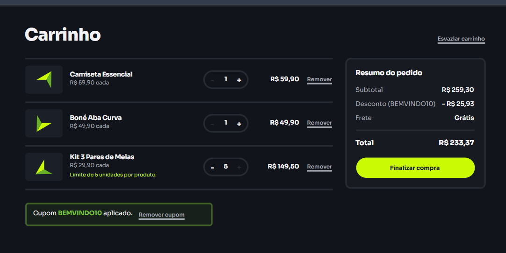

## 🔌 Cenários de API

**Convenções:** a API fica em `/api` e usa sempre JSON (`Content-Type: application/json`). Carrinho base: P001 x1 + P004 x1 + P006 x5 (subtotal 259.3).

### Cenário 16: Calcular o carrinho sem cupom (CA06, CA07, CA10)
- **Dado** que tenho um carrinho base
- **Quando** envio `POST /api/carrinho/calcular` com o carrinho base e sem o campo `cupom`
- **Então** a resposta deve ser 200
- **E** o `subtotal` deve ser 259.3, o `desconto` deve ser 0 e o `frete` deve ser 0
- **E** `freteGratis` deve ser `true` e `valorFaltanteFreteGratis` deve ser 0
- **E** o `total` deve ser 259.3
- **E** `cupom` deve ser `null`

   **Resultado da Execução:** ✅ Passou
   **Evidência:**
   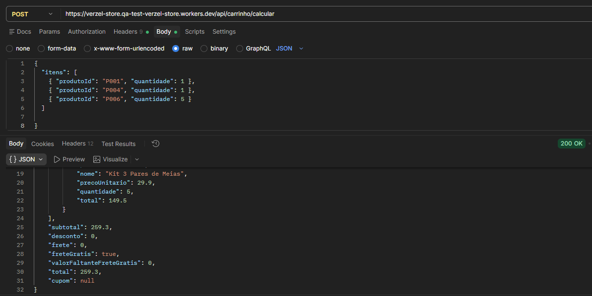

### Cenário 17: Calcular o carrinho com cupom válido (CA01, CA08, CA09, CA11)
- **Dado** que tenho um carrinho base
- **Quando** envio `POST /api/carrinho/calcular` com o carrinho base e `"cupom": "BEMVINDO10"`
- **Então** a resposta deve ser 200
- **E** o `desconto` deve ser 25.93 (e não 25.930000000000003)
- **E** o `frete` deve continuar 0
- **E** o `total` deve ser 233.37
- **E** `cupom.aplicado` deve ser `true`
- **E** `cupom.mensagem` deve ser "Cupom aplicado: 10% de desconto nos produtos."

   **Resultado da Execução:** ✅ Passou
   **Evidência:**
   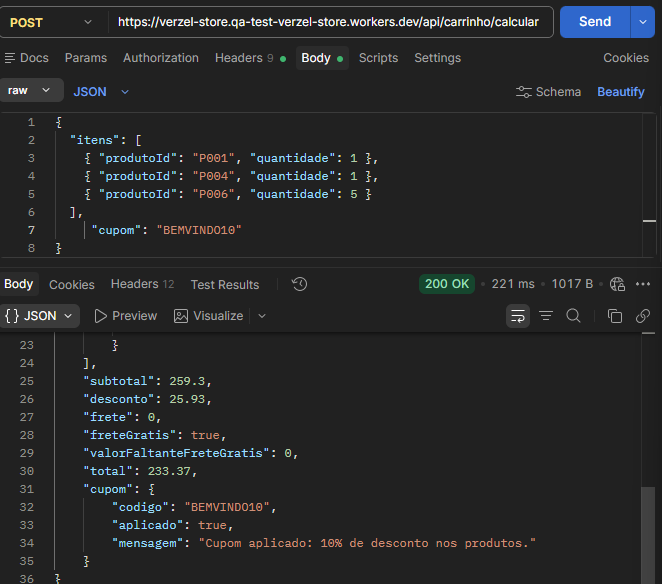

### Cenário 18: Cupom expirado, inexistente ou malformado não gera erro no cálculo (CA02, CA03, CA04)
- **Dado** que tenho um carrinho base
- **Quando** envio `POST /api/carrinho/calcular` com o carrinho base e `"cupom": <cupom>`
- **Então** a resposta deve ser 200
- **E** o `desconto` deve ser 0
- **E** o `total` deve ser 259.3
- **E** `cupom.aplicado` deve ser `false`
- **E** `cupom.mensagem` deve ser `<mensagem>`

Exemplos:

   | cupom         | mensagem        | observação                    |
   |---            |---              |---                            |
01-| "VERAO2026"   | Cupom expirado. | expirado em 31/03/2026        |
02-| "CUPOM123"    | Cupom inválido. | inexistente                   |
03-| "BEMVINDO 10" | Cupom inválido. | espaço no meio não é ignorado |

   **Resultado da Execução:(01)** ✅ Passou
   **Evidência:**
   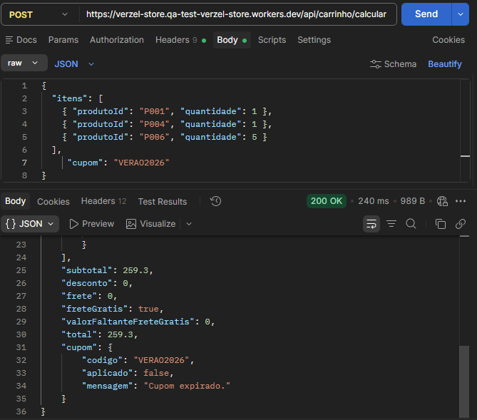

   **Resultado da Execução:(02)** ✅ Passou
   **Evidência:**
   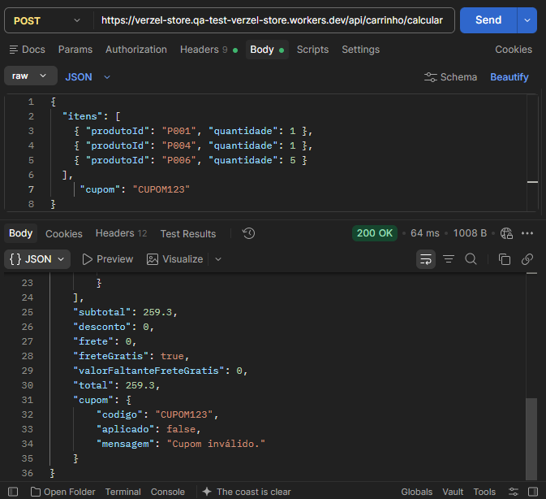

   **Resultado da Execução:(03)** ✅ Passou
   **Evidência:**
   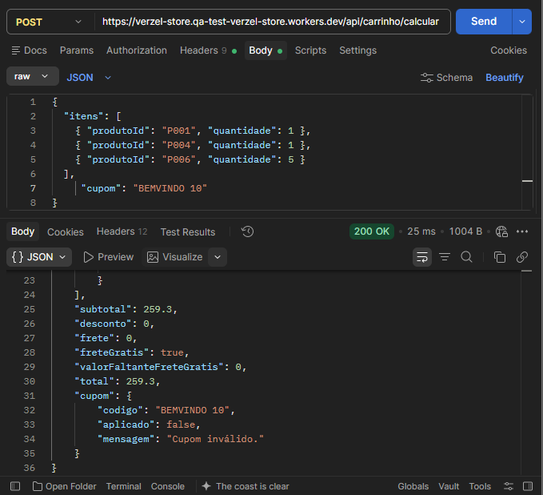

### Cenário 19: Cupom aceito com variação de maiúsculas e espaços pela API (CA02)
- **Dado** que tenho um carrinho base
- **Quando** envio `POST /api/carrinho/calcular` com o carrinho base e `"cupom": <cupom>`
- **Então** `cupom.aplicado` deve ser `true`
- **E** o `desconto` deve ser 25.93

Exemplos:

| cupom            | observação           |
|---               |---                   |
| "bemvindo10"     | minúsculas           |
| " BEMVINDO10 "   | espaços nas pontas   |
| "  bemvindo10  " | minúsculas e espaços |

### Cenário 20: Frete e valor faltante nos limites de R$ 200,00 (CA06, CA07)
- **Dado** que a API do carrinho está disponível
- **Quando** envio `POST /api/carrinho/calcular` com os itens `<itens>` e sem cupom
- **Então** o `frete` deve ser `<frete>`
- **E** `freteGratis` deve ser `<freteGratis>`
- **E** `valorFaltanteFreteGratis` deve ser `<faltante>`
- **E** o `total` deve ser `<total>`

Exemplos:

   | itens                       | subtotal | frete | freteGratis | faltante | total | observação            |
   |---                          |---       |---    |---          |---       |---    |---                    |
01-| P006 x1                     | 29.9     | 19.9  | false       | 170.1    | 49.8  | menor valor possível  |
02-| P005 x1                     | 100      | 19.9  | false       | 100      | 119.9 | valor intermediário   |
03-| P004 x1 + P005 x1 + P008 x1 | 199.9    | 19.9  | false       | 0.1      | 219.8 | logo abaixo do limite |
04-| P005 x2                     | 200      | 0     | true        | 0        | 200   | exatamente no limite  |
05-| P007 x1                     | 229.9    | 0     | true        | 0        | 229.9 | acima do limite       |

   **Resultado da Execução:(01)** ✅ Passou
   **Evidência:**
   

   **Resultado da Execução:(02)** ✅ Passou
   **Evidência:**
   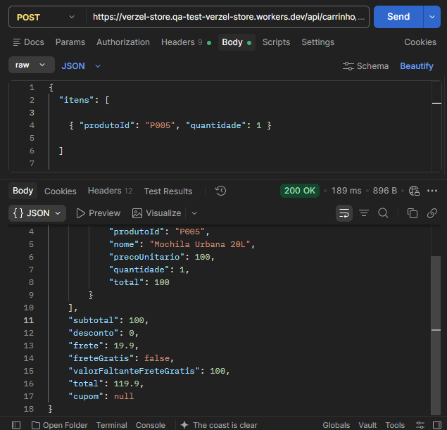

   **Resultado da Execução:(03)** ✅ Passou
   **Evidência:**
   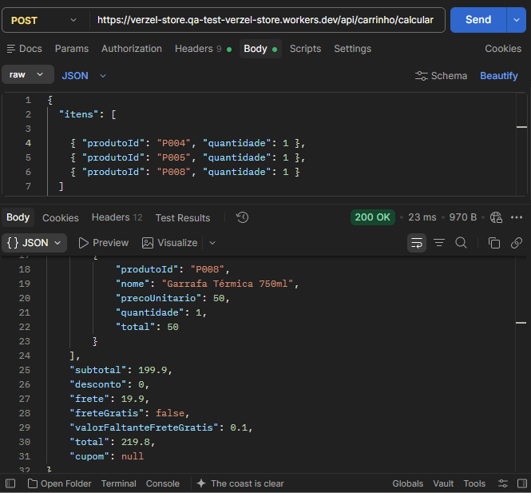
   
   **Resultado da Execução:(02)** ❌ Falhou
   **Evidência e Detalhes:** 
   

   **Resultado da Execução:(05)** ✅ Passou
   **Evidência:**
   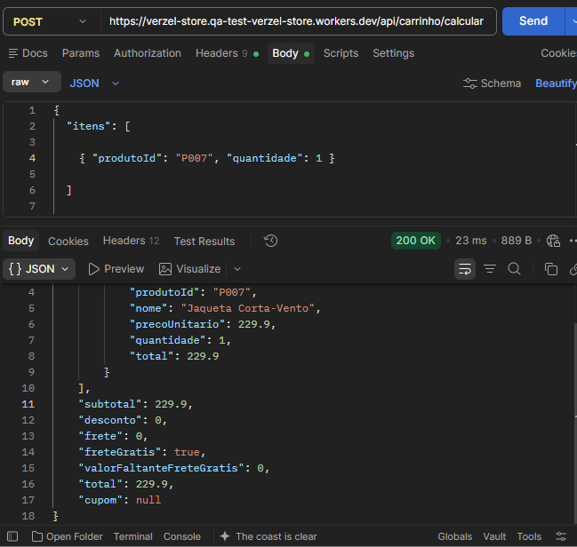

### Cenário 21: Frete avalia o subtotal antes do desconto e o cupom não incide sobre o frete (CA01, CA08, CA09, CA11)
- **Dado** que a API do carrinho está disponível
- **Quando** envio `POST /api/carrinho/calcular` com os itens `<itens>` e `"cupom": "BEMVINDO10"`
- **Então** o `desconto` deve ser `<desconto>`
- **E** o `frete` deve ser `<frete>`
- **E** `valorFaltanteFreteGratis` deve ser `<faltante>`
- **E** o `total` deve ser `<total>`

Exemplos:
 
   | itens             | subtotal | desconto | frete | faltante | total  | observação                                      |
   |---                |---       |---       |---    |---       |---     |---                                              |
01-| P005 x1           | 100      | 10       | 19.9  | 100      | 109.9  | frete cobrado integralmente, sem desconto       |
02-| P005 x2           | 200      | 20       | 0     | 0        | 180    | limite exato, pós-desconto abaixo de 200        |
03-| P003 x1 + P006 x1 | 219.8    | 21.98    | 0     | 0        | 197.82 | zona de risco: bruto >= 200, pós-desconto < 200 |
04-| P002 x1 + P004 x2 | 239.7    | 23.97    | 0     | 0        | 215.73 | exemplo do card                                 |

   **Resultado da Execução:(01)** ✅ Passou
   **Evidência:**
   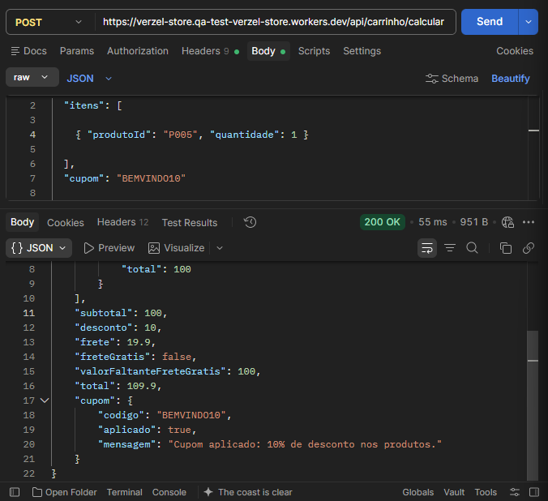

   **Resultado da Execução:(02)** ❌ Falhou
   **Evidência e Detalhes:** 
   

   **Resultado da Execução:(03)** ✅ Passou
   **Evidência:**
   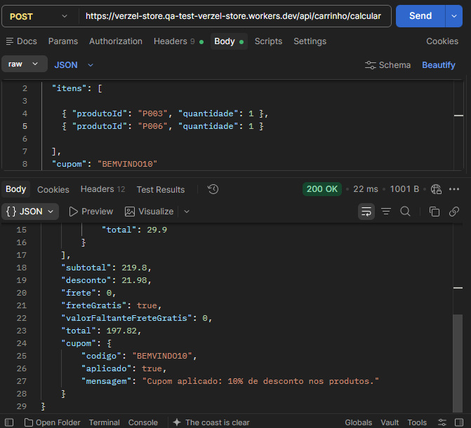

   **Resultado da Execução:(04)** ✅ Passou
   **Evidência:**
   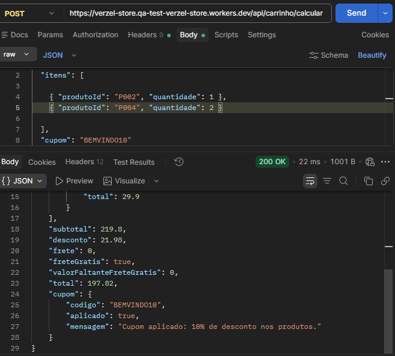

### Cenário 22: Limites de quantidade por produto (CA10)
- **Dado** que a API do carrinho está disponível
- **Quando** envio `POST /api/carrinho/calcular` com o item `{ "produtoId": "P006", "quantidade": <quantidade> }`
- **Então** o código de erro deve ser `<codigo>`

Exemplos:

   | quantidade | status | codigo                     | observação       |
   |---         |---     |---                         |---               |
01-| 6          | 422    | QUANTIDADE_MAXIMA_EXCEDIDA | acima do máximo  |
02-|10000000... | 422    |QUANTIDADE_MAXIMA_EXCEDIDA  |  Overflow        |
03-| 0          | 422    | QUANTIDADE_INVALIDA        | abaixo do mínimo |
04-| -1         | 422    | QUANTIDADE_INVALIDA        | negativo         |
05-| 1.5        | 422    | QUANTIDADE_INVALIDA        | não inteiro      |

   **Resultado da Execução:(01)** ❌ Falhou
   **Evidência e Detalhes:** 
   

   **Resultado da Execução:(02)** ❌ Falhou
   **Evidência e Detalhes:** 
   

   **Resultado da Execução:(04)** ✅ Passou
   **Evidência:**
   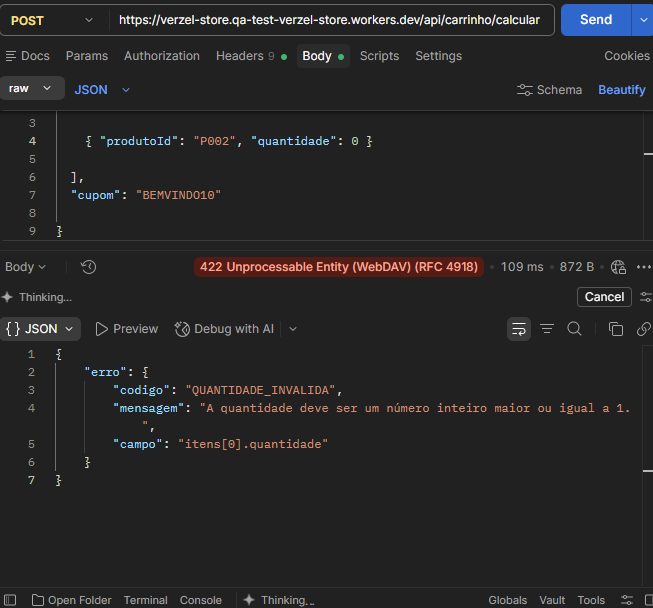
   
   **Resultado da Execução:(04)** ✅ Passou
   **Evidência:**
   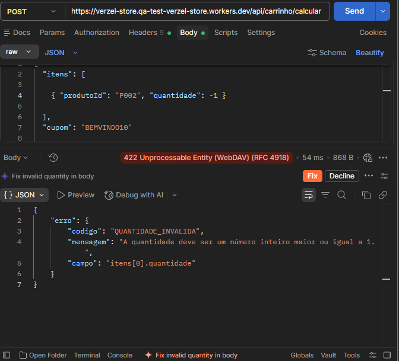

   **Resultado da Execução:(04)** ✅ Passou
   **Evidência:**
   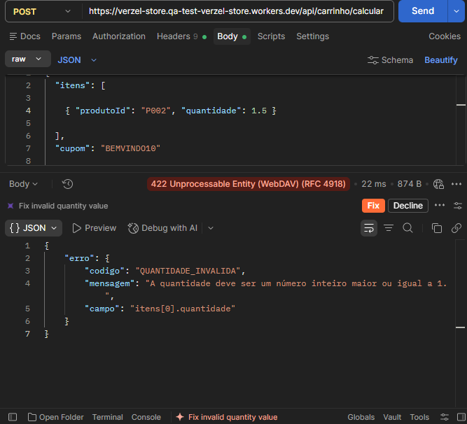

### Cenário 23: Validação dos itens da requisição
- **Dado** que existem 8 produtos cadastrados na loja
- **Quando** envio `POST /api/carrinho/calcular` com `<itens>`
- **Então** a resposta deve ser 422
- **E** o código de erro deve ser `<codigo>`

Exemplos:

  | itens                                                                                    | codigo                 | observação             |
  |---                                                                                       |---                     |---                     |
01| `"itens": []`                                                                            | ITENS_OBRIGATORIOS     | lista vazia            |
02| `[ { "quantidade": 1 } ]`                                                                | PRODUTO_NAO_ENCONTRADO | sem `produtoId`        |
03| `[ { "produtoId": "P001" } ]`                                                            | QUANTIDADE_INVALIDA    | sem `quantidade`       |
04| `[ { "produtoId": "P999", "quantidade": 1 } ]`                                           | PRODUTO_NAO_ENCONTRADO | produto inexistente    |
05| `[ { "produtoId": "P006", "quantidade": 3 }, { "produtoId": "P006", "quantidade": 3 } ]` | ITEM_DUPLICADO         | mesmo produto repetido |

   **Resultado da Execução:(01)** ✅ Passou
   **Evidência:**
   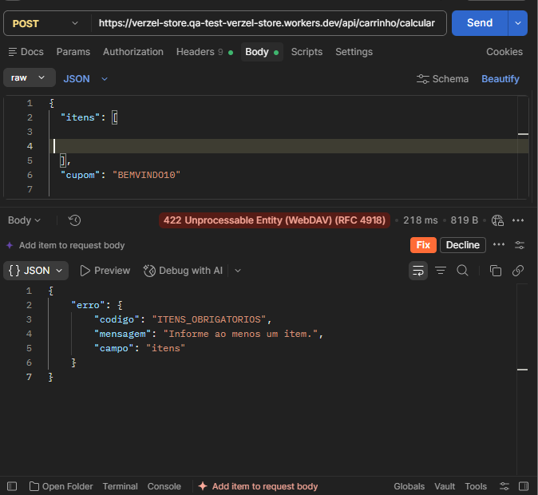

   **Resultado da Execução:(02)** ✅ Passou
   **Evidência:**
   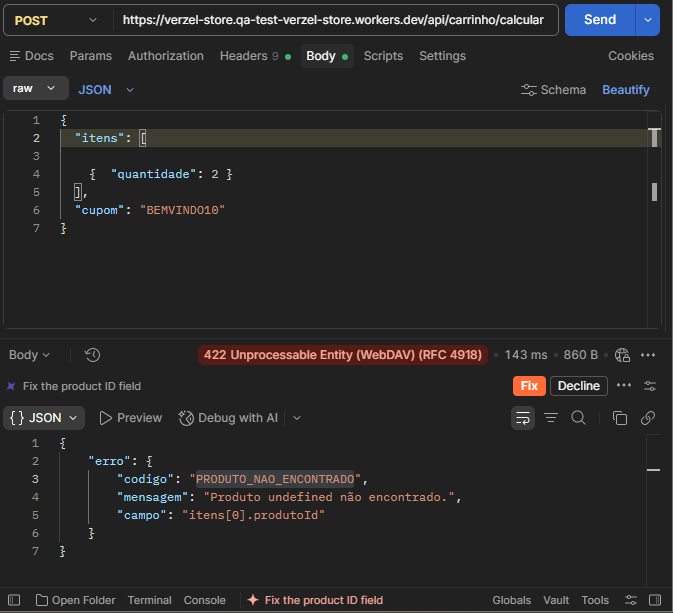

   **Resultado da Execução:(03)** ✅ Passou
   **Evidência:**
   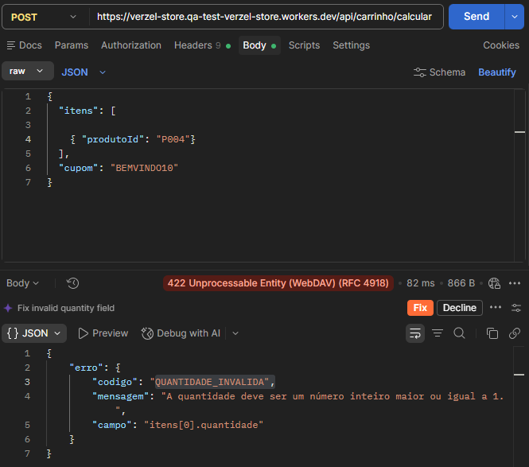

   **Resultado da Execução:(04)** ✅ Passou
   **Evidência:**
   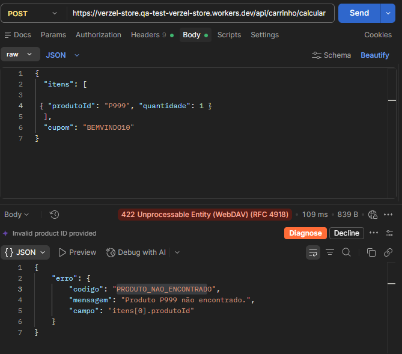

   **Resultado da Execução:(05)** ✅ Passou
   **Evidência:**
   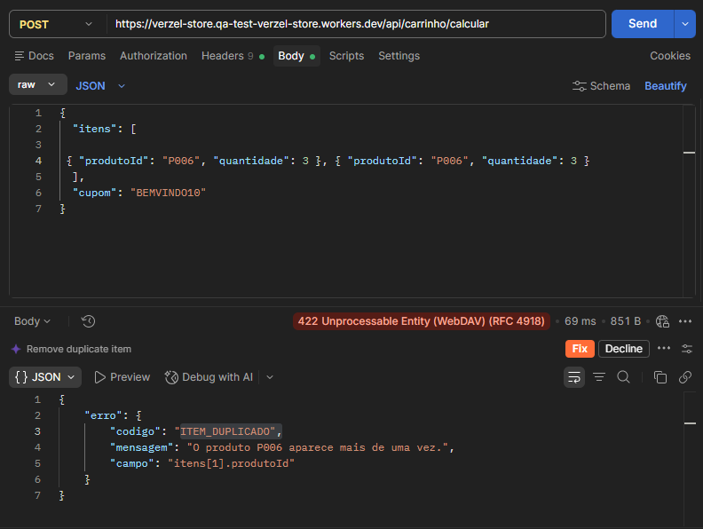

### Cenário 24: Validação dos dados do cliente
- **Dado** que os dados do cliente são válidos
- **Quando** envio `POST /api/pedidos` alterando apenas o campo `<campo>` para `<valor>`
- **Então** a resposta deve ser `<status>`
- **E** `campos` deve indicar `<campo>` quando houver erro

Exemplos:

   | campo | valor                  | status | observação          |
   |---    |---                     |---     |---                  |
01-| nome  | "Maria Silva"          | 201    | nome e sobrenome    |
02-| nome  | "Maria"                | 422    | só o nome           |
03-| nome  | ""                     | 422    | vazio               |
04-| email | "usuario@dominio..com" | 422    | sem domínio         |
05-| cep   | "01310100"             | 201    | 8 dígitos sem hífen |
06-| cep   | "0131010"              | 422    | 7 dígitos           |
07-| cep   | "013101000"            | 422    | 9 dígitos           |
08-| cep   | "abcde-fgh"            | 422    | letras              |
09-| cep   | ""                     | 422    | vazio               |

   **Resultado da Execução:(01)** ✅ Passou
   **Evidência:**
   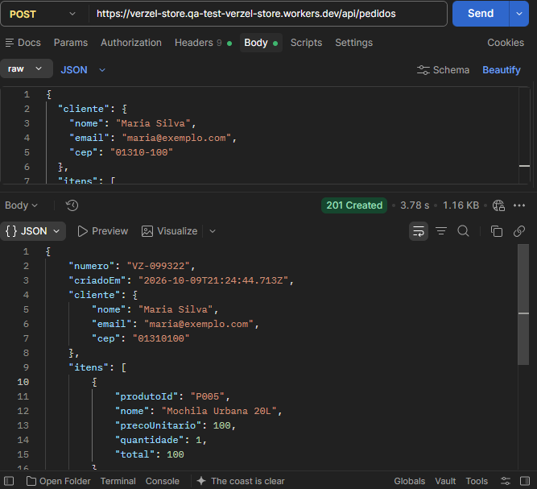

   **Resultado da Execução:(02)** ✅ Passou
   **Evidência:**
   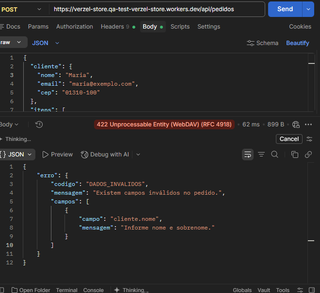

   **Resultado da Execução:(03)** ✅ Passou
   **Evidência:**
   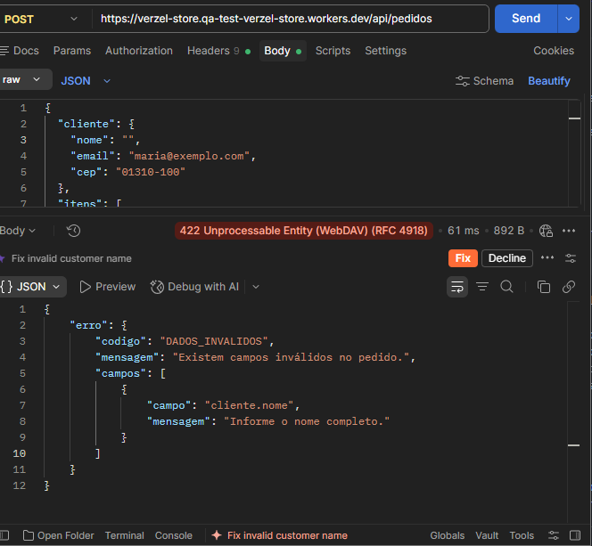

   **Resultado da Execução:(04)** ❌ Falhou
   **Evidência e Detalhes:** 
   

   **Resultado da Execução:(05)** ✅ Passou
   **Evidência:**
   

   **Resultado da Execução:(06)** ✅ Passou
   **Evidência:**
   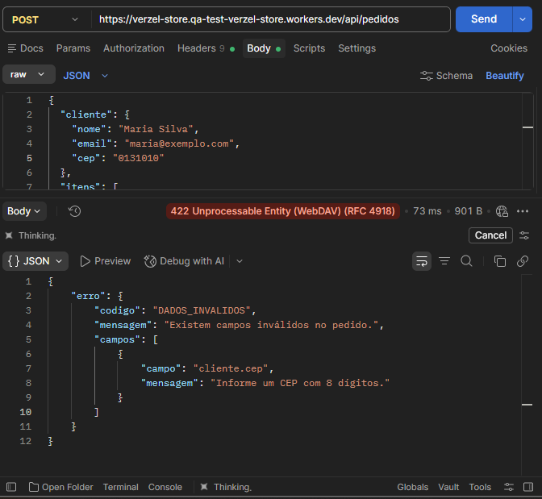

   **Resultado da Execução:(07)** ✅ Passou
   **Evidência:**
   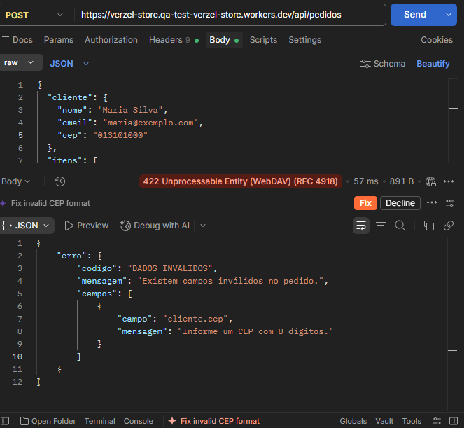

   **Resultado da Execução:(08)** ✅ Passou
   **Evidência:**
   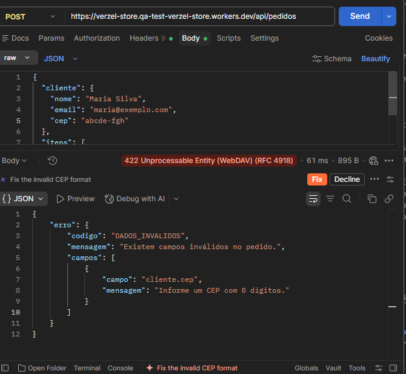

   **Resultado da Execução:(09)** ✅ Passou
   **Evidência:**
   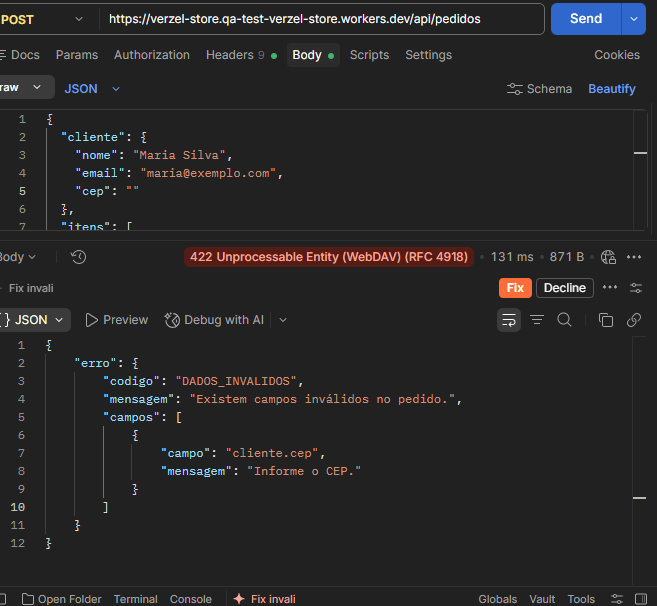

### Cenário 25: Vários dados do cliente inválidos ao mesmo tempo
- **Dado** que a API de pedidos está disponível
- **Quando** envio `POST /api/pedidos` com nome "Maria", e-mail "maria" e CEP "123"
- **Então** a resposta deve ser 422
- **E** o código de erro deve ser `DADOS_INVALIDOS`
- **E** `campos` deve listar os três campos inválidos

   **Resultado da Execução:(09)** ✅ Passou
   **Evidência:**
   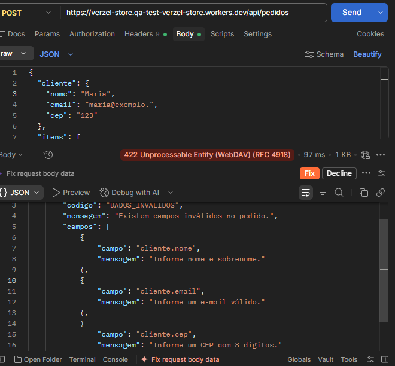

### Cenário 26: Listar produtos
- **Dado** que existem 8 produtos cadastrados na loja
- **Quando** envio `GET /api/`
- **Então** a resposta deve ser 200
- **E** a lista deve ter 8 produtos
- **E** cada produto deve ter `id`, `nome`, `descricao`, `categoria` e `preco`
- **E** os preços devem ser os da tabela de dados de teste (ex.: P001 = 59.9, P007 = 229.9)

   **Resultado da Execução:(09)** ✅ Passou
   **Evidência:**
   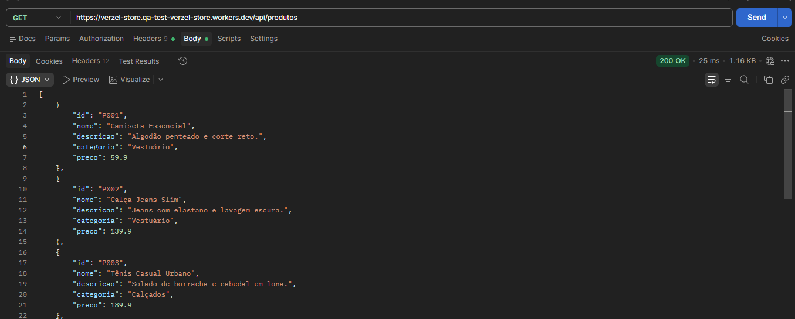

   **Resultado da Execução:(09)** ✅ Passou
   **Evidência:**
   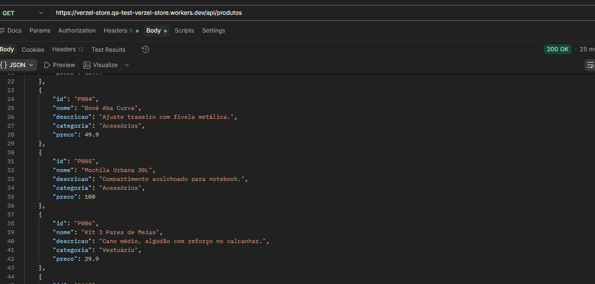

   **Resultado da Execução:(09)** ✅ Passou
   **Evidência:**
   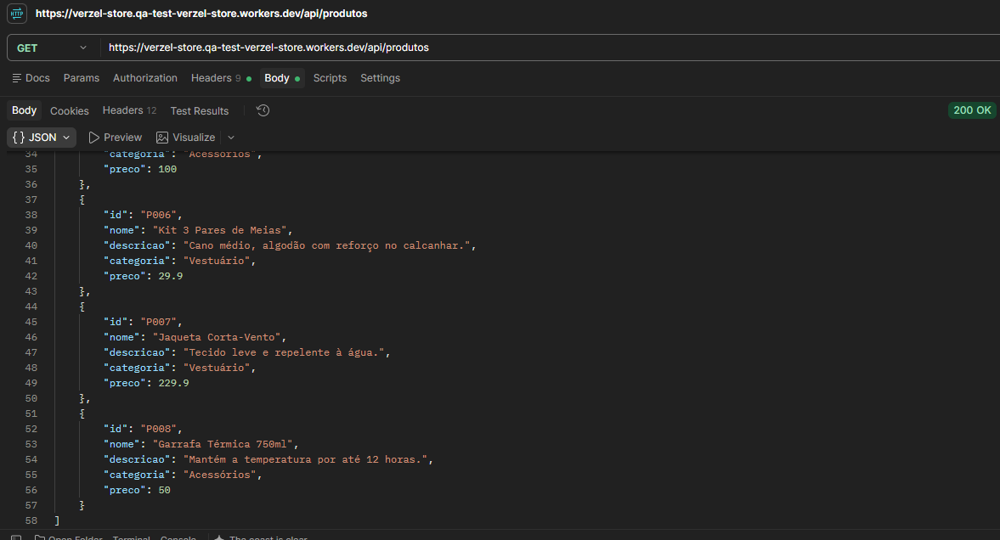

### Cenário 27: Consultar produto por id
- **Dado** que existem 8 produtos cadastrados na loja 
- **Quando** envio `GET /api/produtos/<id>`
- **Então** a resposta deve ser `<status>`
- **E** o corpo deve ser `<resultado>`

Exemplos:

   | id   | status | resultado                                      |
   |---   |---     |---                                             |
01-| P001 | 200    | produto "Camiseta Essencial" com `preco` 59.9  |
02-| P008 | 200    | produto "Garrafa Térmica 750ml" com `preco` 50 |
03-| P999 | 404    | erro `PRODUTO_NAO_ENCONTRADO`                  |

   **Resultado da Execução:(01)** ✅ Passou
   **Evidência:**
   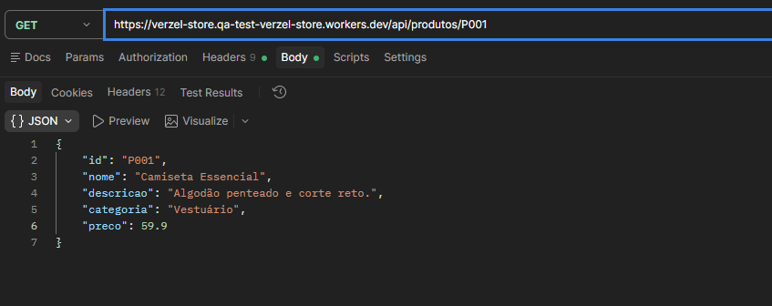

   **Resultado da Execução:(02)** ✅ Passou
   **Evidência:**
   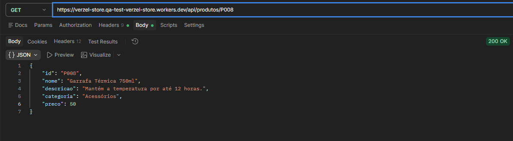

   **Resultado da Execução:(03)** ✅ Passou
   **Evidência:**
   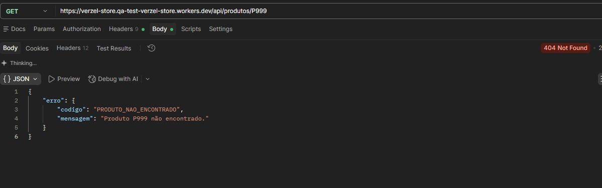

## 📌 Pontos a confirmar
- **Cenário 05:** usa "VERAO2026" (expirado) como segundo cupom. Definir um segundo cupom válido e a mensagem exata exibida.
- **Cenário 07:** definir se o valor faltante é omitido ou exibido como R$ 0,00 a partir de R$ 200,00 (a API retorna 0).
- **Dados de teste:** o preço de P003 (R$ 189,90) foi deduzido de P003 + P006 = 219,80.
- **API:** definir o resultado esperado para quantidade como texto (`"2"`) ou `null`, e-mail sem extensão (`maria@exemplo`) e id de produto em minúsculas (`p001`).
